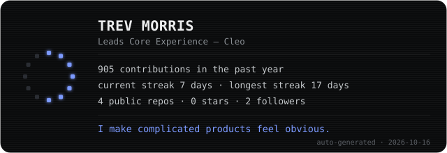

The card is drawn from my GitHub numbers whenever I run it. See <a href="./build.js"><code>build.js</code></a>.

 

I lead Core Experience at Cleo, an AI money assistant used by 7 million
people, and I'm its first Staff Product Designer. 13 years across fintech,
broadcast and consumer apps.

Case studies, side projects and my design system work are on
**[designedbytrev.com](https://designedbytrev.com/)**.

 

**[designbytrev@gmail.com](mailto:designbytrev@gmail.com)** or [LinkedIn](https://www.linkedin.com/in/trevmorris/)

